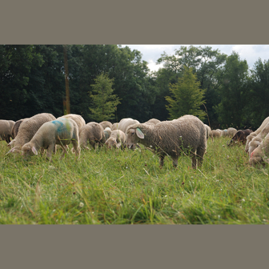

# T2V-AttnDisrupt

Official implementation of **T2V-AttnDisrupt: Inducing Hallucinations in LVLMs via Misrouting Visual Evidence Retrieval** (NeurIPS 2026).

This release provides the **LLaVA-1.5-7B** attention-disruption attack and five recorded clean/adversarial captioning examples. The attack maximizes prompt-to-image attention entropy change, relative clean Top-k mass suppression, and Jensen–Shannon divergence, without a target response or output-token supervision.

## Attack configuration

| Setting | Value |
| --- | --- |
| Surrogate model | `liuhaotian/llava-v1.5-7b` |
| Decoder layers | 5–18, zero indexed |
| Salient visual tokens | Clean Top-50 |
| Objective | `ΔH + 5 × (1 − adv_topk_mass / clean_topk_mass) + JS` |
| PGD | 50 steps, random start, step size `2/255` |
| Perturbation budget | RGB L∞ ≤ `8/255` on the **336×336 model-input canvas after official padding and resizing; padding pixels are included** |
| Prompt | `Please describe this image in detail.` |
| Decoding | Beam size 3, no sampling, at most 256 new tokens |

The budget is enforced before RGB normalization. It is a constraint on the preprocessed canvas, including padding, rather than a verified constraint in the original JPEG's resolution. Both captions are generated from the saved 8-bit RGB inputs. This input-space definition should be retained when comparing results.

## Installation

The recorded examples used Python 3.10.16 and one RTX 4090 with 24 GB memory. Use a Python 3.10 environment with CUDA-capable PyTorch:

```bash
git clone https://github.com/toastpear/T2V-AttnDisrupt.git
cd T2V-AttnDisrupt
python -m pip install -r requirements.txt
python -m pip install --no-deps "git+https://github.com/haotian-liu/LLaVA.git@c121f0432da27facab705978f83c4ada465e46fd"
```

Use an **upstream LLaVA-format** checkpoint, not the `llava-hf` conversion. The LLaVA checkpoint and its `openai/clip-vit-large-patch14-336` vision tower must be available locally or through the Hugging Face cache. Model weights are not bundled.

## Run the five examples

```bash
CUDA_VISIBLE_DEVICES=0 python run_attack.py \
  --model-path liuhaotian/llava-v1.5-7b \
  --output runs/llava5
```

A local checkpoint directory may be supplied to `--model-path`. A quick single-image check is:

```bash
CUDA_VISIBLE_DEVICES=0 python run_attack.py \
  --model-path /path/to/llava-v1.5-7b \
  --limit 1 --iters 1 --max-new-tokens 64 \
  --output runs/smoke
```

Use a new output directory for each run. For a remote experiment, launch the command in a persistent session, for example:

```bash
tmux new -s t2v_llava5
# Run the command above inside this session.
```

The default dataset is [data/samples.json](data/samples.json), with images in `data/images/`. A custom manifest can be supplied with `--manifest` and `--images`; it is a JSON list with `image_id`, `file_name`, and `references` (a list of captions, retained only as output metadata). Reference captions are not used by the attack objective.

## Recorded results

The examples use the first five entries of the existing COCO validation split, with seeds 42–46. They were not selected by attack outcome. All ten captions are preserved in [examples/outputs/results.json](examples/outputs/results.json), and [examples/README.md](examples/README.md) shows every clean/adversarial pair.

Example: COCO image 230166.

| Clean model input | Adversarial model input |
| --- | --- |
|  |  |

The clean caption describes sheep grazing in a field. The adversarial caption additionally describes a sheepdog and human figures. See the recorded captions for the full text. A change in wording alone is not counted as an attack-success metric.

Each output directory contains:

- `clean.png`, `adv.png`: the actual 336×336 RGB model inputs.
- `delta.png`: amplified difference, `(adv − clean) / (2ε) + 0.5`.
- `inputs.pt`: exact `clean_rgb` and `adv_rgb` tensors.
- `history.jsonl`: all PGD steps, objective terms, gradient magnitude, and RGB budget.
- `result.json`: the two captions, image hash, seed, attention span, and final attention statistics.

## Validation

Validate the bundled images, source hashes, 50-step histories, and PNG budget without loading a model:

```bash
python validation/validate_examples.py
```

For a saved example, [validation/runtime_checks.json](validation/runtime_checks.json) records identical attention objectives and image gradients for the full decoder and the memory-saving early-stop path. It also records identical vision outputs before/after enabling input gradients, and exact PNG round trips through the official processor. Re-run this GPU check with:

```bash
CUDA_VISIBLE_DEVICES=0 python validation/verify_runtime.py \
  --model-path /path/to/llava-v1.5-7b \
  --image data/images/000000107554.jpg \
  --results examples/outputs/000000107554 \
  --output runs/runtime_checks.json
```

## Citation

```bibtex
@inproceedings{bian2026t2v,
  title={T2V-AttnDisrupt: Inducing Hallucinations in LVLMs via Misrouting Visual Evidence Retrieval},
  author={Bian, Yuran and Wang, Xiaoyan and Zheng, Conghui and Zhang, Xiaohan and Pan, Li},
  booktitle={Advances in Neural Information Processing Systems},
  year={2026}
}
```

## License

The repository retains its [MIT license](LICENSE). See [third party notices](THIRD_PARTY_NOTICES.md) for LLaVA, example-image, and model-weight attribution.
