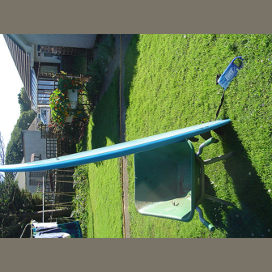
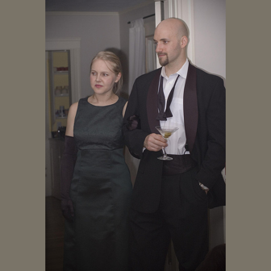
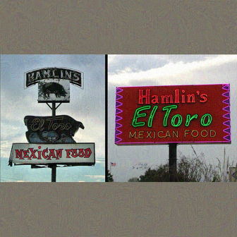
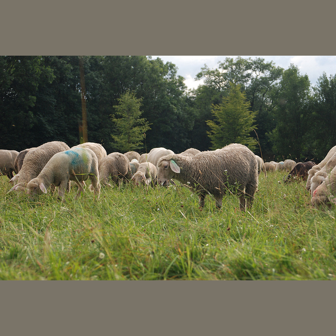
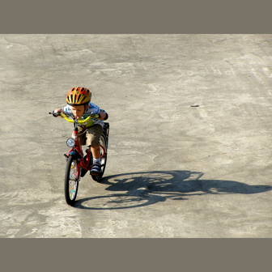
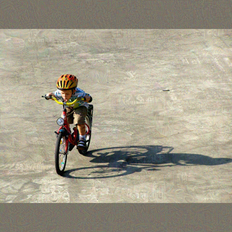

# Recorded LLaVA-1.5-7B examples

Five fixed COCO validation images, seeds 42–46. All captions below are the recorded model outputs. The RGB budget is defined on the 336×336 padded/resized model input, including padding.

## COCO 000000107554

| Clean input | Adversarial input |
| --- | --- |
|  |  |

### Clean caption

The image depicts a backyard scene with a blue surfboard leaning against a green lawn chair. The surfboard is positioned horizontally, while the lawn chair is placed upright nearby. The backyard is adorned with several potted plants scattered around, adding a touch of greenery to the space.

In addition to the surfboard and lawn chair, there are two bottles visible in the scene, one near the top left corner and the other near the top right corner of the image. The overall atmosphere of the backyard suggests a relaxing and leisurely environment.

### Adversarial caption

The image depicts a backyard scene with a blue plastic lawn chair lying on its side in the grass. The chair appears to have been flipped over, possibly as a result of a playful moment or an accident.

In the background, there is a person standing near the chair, possibly observing the situation or preparing to interact with the chair. Additionally, there is a dog in the scene, located towards the left side of the image, possibly enjoying the outdoors or accompanying the person. A potted plant can also be seen in the background, adding a touch of greenery to the scene.

## COCO 000000021167

| Clean input | Adversarial input |
| --- | --- |
|  |  |

### Clean caption

The image features a man and a woman standing next to each other, both dressed in formal attire. The man is wearing a suit and tie, while the woman is dressed in a green dress. They appear to be posing for a picture, with the man holding a martini glass in his hand.

In the background, there is a dining table with several bottles and cups placed on it, suggesting that they might be attending a social event or gathering.

### Adversarial caption

The image features a man and a woman standing next to each other, both dressed in formal attire. The man is wearing a suit and tie, while the woman is wearing a dress. They are both holding martinis in their hands, enjoying a cocktail together.

In the background, there are several books scattered around, possibly indicating that they are in a library or a room with a collection of books. The overall atmosphere of the scene suggests a sophisticated and elegant gathering.

## COCO 000000260657

| Clean input | Adversarial input |
| --- | --- |
|  |  |

### Clean caption

The image consists of two photographs of a Mexican food restaurant. The first photograph is a close-up of the restaurant's sign, showcasing its neon lights and the name "Hamlin's El Toro." The second photograph is a broader view of the restaurant, capturing the entire sign and its surroundings.

In the background of the second photograph, there are two American flags, one on the left side and the other on the right side of the image. These flags add a patriotic touch to the restaurant's atmosphere.

### Adversarial caption

The image showcases a street sign for a Mexican food restaurant called "Hamlin's E-70." The restaurant is located at the intersection of Nixon Canyon Road and Hamlin's E-70. The sign is prominently displayed on the side of the road, making it easy for passersby to spot.

In addition to the main sign, there is a smaller sign on the left side of the main sign, possibly providing more information about the restaurant or its offerings. Overall, the scene conveys a welcoming atmosphere for those looking for a delicious meal at Hamlin's E-70.

## COCO 000000230166

| Clean input | Adversarial input |
| --- | --- |
|  |  |

### Clean caption

The image depicts a large herd of sheep grazing in a lush green field. There are at least 14 sheep visible in the scene, scattered throughout the field. Some of the sheep are closer to the foreground, while others are further in the background. The sheep appear to be enjoying their time grazing on the grass, creating a peaceful and pastoral scene.

### Adversarial caption

The image depicts a herd of sheep grazing in a lush green field. Among the sheep, there is a sheepdog, possibly a border collie, watching over the flock. The sheep are scattered throughout the field, with some closer to the foreground and others further in the background.

In addition to the sheep and the sheepdog, there are several human figures present in the scene. Some of these figures appear to be naked, while others are wearing bathing suits. They seem to be observing the sheep and the sheepdog from a distance. The combination of the sheep, the sheepdog, and the human figures creates a unique and intriguing scene.

## COCO 000000210299

| Clean input | Adversarial input |
| --- | --- |
|  |  |

### Clean caption

The image features a young boy wearing a helmet and riding a bicycle on a concrete surface. The boy appears to be enjoying his time on the bike, possibly learning how to ride it. The bicycle is positioned in the center of the scene, with the boy sitting on it.

In the background, there is another bicycle located towards the right side of the image. Additionally, a backpack can be seen placed on the ground near the center of the scene, possibly belonging to the boy or someone else in the area.

### Adversarial caption

The image features a young boy riding a bicycle on a dirt road. He is wearing a helmet for safety while enjoying his ride. The boy is also carrying a backpack on his back, possibly filled with his belongings or supplies for a journey.

In the background, there is a car parked on the side of the road, possibly belonging to the boy's family or friends. The scene captures a moment of adventure and outdoor exploration for the young boy.
